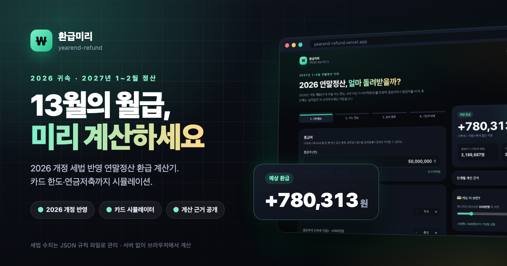
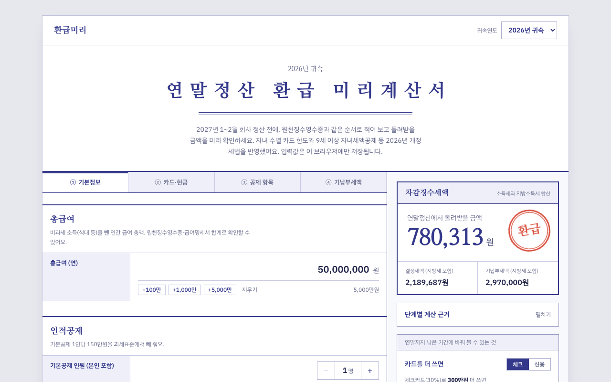

# 환급미리 — 2026 연말정산 환급 계산기

> 13월의 월급, 미리 계산하세요. 2026년 귀속(2027년 1~2월 정산) 개정 세법 반영 예상 환급액 계산기.


## 🔗 라이브 데모

**👉 [https://yearend-refund-delta.vercel.app](https://yearend-refund-delta.vercel.app)**

## ✨ 주요 기능

- 🧾 **단계형 입력** — ① 기본정보 ② 카드·현금 ③ 공제 항목 ④ 기납부세액, 결과는 오른쪽(모바일은 하단 바)에 실시간 반영
- 💰 **큰 숫자 결과 카드** — "예상 환급 +123,456원" / "추가 납부"를 소득세+지방소득세 합산으로
- 🔍 **단계별 계산 근거** — 총급여 → 근로소득공제 → 과세표준 → 산출세액 → 세액공제 항목별 → 결정세액
- 💳 **"카드 더 쓰면?" 시뮬레이터** — 체크/신용카드 추가 사용 시 환급 변화와 공제한도 도달 여부
- 🏦 **"연금저축 더 넣으면?" 슬라이더** — 남은 연금계좌 한도 안에서 환급 증가액
- 👶 **2026 개정 반영** — 자녀 수별 신용카드 기본한도, 9세 이상 자녀세액공제, 출산·입양 공제
- ⚖️ **표준세액공제 자동 비교** — 특별세액공제+월세 vs 13만원 중 유리한 쪽 선택
- 💾 **자동 저장** — 입력값은 localStorage에만 저장 (서버 전송 없음)
- ⏳ **미확정 개정안 안내** — 국회 의결 대기 항목을 화면 하단에 별도 표기

## 📐 세법 규칙은 JSON으로

세법 수치는 코드에 하드코딩하지 않고 `public/rules/<연도>.json` 에 둡니다. 계산 엔진(`src/lib/calc.ts`)은 rules 객체를 인자로 받는 순수 함수입니다.

```
public/rules/index.json   # {"years":[2026],"default":2026}
public/rules/2026.json    # version · taxYear · updatedAt · sources · pending + 모든 세율/한도
```

내년에는 `2027.json` 을 추가하고 `index.json` 의 `years` 에 넣기만 하면 연도 선택 UI에 나타납니다.

## 🧪 계산 엔진 검증

```bash
npm run verify   # npx tsx scripts/verify.ts — 손계산 케이스 대조
```

예: 총급여 5,000만원 · 본인만 → 근로소득공제 1,225만 → 과표 3,625만 → 산출세액 4,177,500원 → 근로소득세액공제 66만(한도) · 표준세액공제 13만 → 결정세액 3,387,500원

## 🛠 기술 스택

React 19 · TypeScript · Vite · Tailwind CSS v4 · tsx(검증 스크립트) · Vercel

## 🚀 로컬 실행

```bash
npm install && npm run dev
```

## ⚠️ 면책

참고용 추정치입니다. 소득공제 종합한도, 기부금 소득 대비 한도 등 일부 세부 규정은 단순화되어 있어 실제 정산 결과와 다를 수 있습니다.

## 📸 스크린샷


